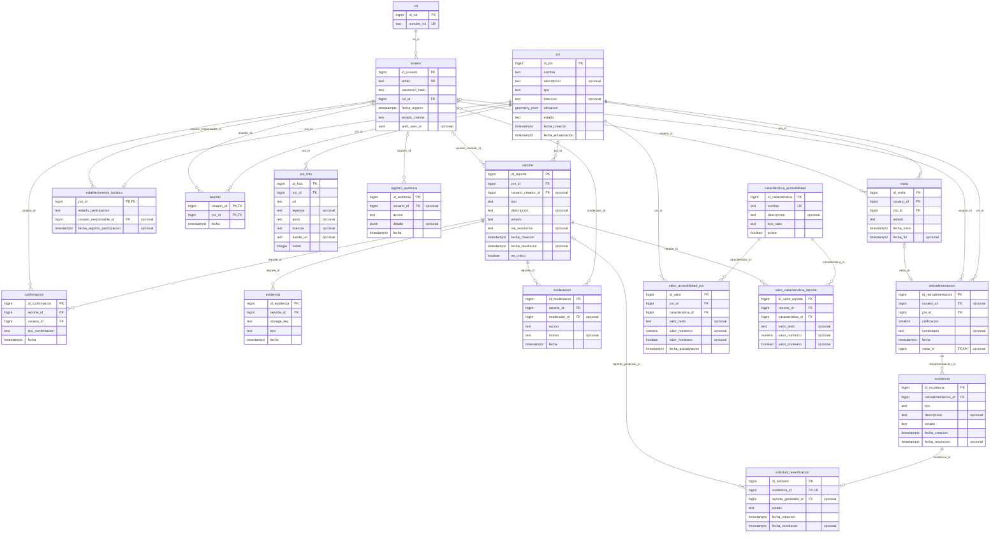

# 04. Modelo entidad-relación (MER) — versión final

> **Estado: aprobado y vigente (8 nov 2026).** Reemplaza la propuesta en pausa
> del 17/10/2026. El modelo se **genera desde la base de producción** (AWS RDS,
> `omnitravel_db`), así que coincide con el código: auditoría NC-04 y 6.5.

| Pieza | Archivo | Cómo se mantiene |
|---|---|---|
| Diagrama MER | [`docs/modelo-datos/mer.png`](../modelo-datos/mer.png) · [`.svg`](../modelo-datos/mer.svg) · fuente Mermaid [`mer.mmd`](../modelo-datos/mer.mmd) | `npm run generar-mer` (lee el catálogo de PostgreSQL) |
| Esquema físico completo | [`backend/sql/000-esquema-base.sql`](../../backend/sql/000-esquema-base.sql) | `npm run exportar-esquema` |
| Migraciones versionadas | `backend/sql/001…004-*.sql` | `npm run migrar` (registro en `migracion_aplicada`) |
| Catálogos (roles y características) | `backend/sql/catalogos.sql` | Idempotente |
| Verificación automática | `backend/test/integracion/` (20 casos) | CI crea una base PostGIS con 000…004 y prueba la API contra ella |

## 1. Entidades (18 tablas)

| Tabla | Proceso | Responsabilidad | PK | Restricciones relevantes |
|---|---|---|---|---|
| `rol` | Transversal | Roles del sistema | `id_rol` | `nombre_rol` único; CHECK ∈ {viajero, colaborador, establecimiento, moderador, administrador} |
| `usuario` | Transversal | Cuenta: correo, hash bcrypt, rol y estado. **No** guarda el perfil de discapacidad (ADR-09, Ley 1581) | `id_usuario` | `email` único; FK `rol_id`; CHECK `estado_cuenta` |
| `poi` | P1, P2, P3 | Lugar (punto de interés) con ubicación PostGIS `geometry(Point, 4326)` | `id_poi` | CHECK `estado` ∈ {pendiente, publicado, en_revision, rechazado}; índice GiST en `ubicacion` |
| `poi_foto` | P1 | Fotos de referencia con autor y licencia | `id_foto` | Única (`poi_id`, `url`) |
| `caracteristica_accesibilidad` | P1, P2 | Catálogo extensible (rampa, ascensor, baño, Braille, podotáctil, semáforo sonoro, ancho de puerta) | `id_caracteristica` | `nombre` único; CHECK `tipo_valor` |
| `valor_accesibilidad_poi` | P1, P2 | Valor vigente de cada característica en cada lugar | `id_valor` | **Única (`poi_id`, `caracteristica_id`)** (migración 004) |
| `reporte` | P1 | Aporte comunitario (nuevo lugar, actualización, barrera o re-verificación) | `id_reporte` | CHECK `estado`, CHECK `via_resolucion` ∈ {automatica, manual} |
| `valor_caracteristica_reporte` | P1 | Valores propuestos por el reporte | `id_valor_reporte` | FK a `reporte` (cascada) y a la característica |
| `evidencia` | P1 | Foto del reporte: solo la llave de S3 (`storage_key`), no el binario (ADR-07) | `id_evidencia` | CHECK `tipo` ∈ {foto, documento} |
| `confirmacion` | P1 | Validación de otros viajeros (consenso de 3) | `id_confirmacion` | **Única (`reporte_id`, `usuario_id`)** (004); CHECK `tipo_confirmacion` |
| `moderacion` | P1 | Decisión del moderador (vía B) | `id_moderacion` | CHECK `accion` |
| `visita` | P3 | Visita real a un lugar (inicio y fin) | `id_visita` | CHECK de estado y de fechas coherentes; **una sola visita en curso por persona** (índice único parcial) |
| `retroalimentacion` | P3 | Experiencia post-viaje (1–5 y comentario) | `id_retroalimentacion` | CHECK 1 ≤ calificación ≤ 5; **una calificación por visita** (único parcial `visita_id`) |
| `incidencia` | P3 | Discrepancia o calificación baja que abre revisión | `id_incidencia` | CHECK `estado` ∈ {abierta, en_proceso, resuelta} |
| `solicitud_reverificacion` | P3 → P1 | Pide a la comunidad nueva evidencia; se cierra al publicar el reporte generado | `id_solicitud` | `incidencia_id` único (1 a 0..1) |
| `favorito` | Transversal | Lugares guardados por la persona | (`usuario_id`, `poi_id`) | PK compuesta: sin duplicados |
| `registro_auditoria` | Transversal | Decisiones de moderación y eventos de cuenta (registro, inicios de sesión, cambios de contraseña y de rol) | `id_auditoria` | `detalle` jsonb sin datos personales |
| `establecimiento_turistico` | Futuro | Participación de establecimientos (rol `establecimiento`) | `poi_id` | 1 a 0..1 con `poi` |

## 2. Relaciones y cardinalidad

| Relación | Cardinalidad | Borrado |
|---|---|---|
| `rol` → `usuario` | 1 : N | Restringido |
| `poi` → `reporte`, `valor_accesibilidad_poi`, `visita`, `retroalimentacion`, `favorito`, `poi_foto` | 1 : N | En cascada (si se elimina el lugar) |
| `reporte` → `confirmacion`, `evidencia`, `valor_caracteristica_reporte`, `moderacion` | 1 : N | En cascada |
| `usuario` → `reporte`, `confirmacion`, `visita`, `retroalimentacion`, `favorito`, `registro_auditoria` | 1 : N | Restringido (visita y favorito en cascada) |
| `visita` → `retroalimentacion` | 1 : 0..1 | `set null` |
| `retroalimentacion` → `incidencia` | 1 : N | En cascada |
| `incidencia` → `solicitud_reverificacion` | 1 : 0..1 | En cascada |
| `reporte` (generado) → `solicitud_reverificacion` | 1 : N | Restringido |
| `caracteristica_accesibilidad` → `valor_*` | 1 : N | Restringido |

## 3. Normalización y redundancia (auditoría 6.5 ítem 4)

- **1FN:** todos los atributos son atómicos; las características variables no
  son columnas de `poi` sino filas de `valor_accesibilidad_poi` (catálogo
  extensible sin alterar tablas).
- **2FN:** las tablas con PK compuesta (`favorito`) no tienen atributos que
  dependan de una parte de la llave.
- **3FN:** no hay dependencias transitivas: el nombre del rol vive en `rol`,
  el nombre de la característica en `caracteristica_accesibilidad`, los datos
  del lugar solo en `poi`. Los conteos (confirmaciones, promedio de
  calificaciones) **no se almacenan**: se calculan con consultas.
- **Redundancia controlada y justificada:** `valor_caracteristica_reporte`
  guarda lo propuesto y `valor_accesibilidad_poi` lo vigente; no es duplicado,
  es historial (el reporte se puede rechazar sin tocar el lugar).
- **Duplicados imposibles por diseño:** índices únicos de la migración 004
  (confirmación por persona, valor por característica), de la 002 (una
  calificación por visita, una visita en curso) y PK compuesta de `favorito`.
  Si la base tuviera duplicados previos, la migración 004 avisa en lugar de
  borrar datos.

## 4. Integridad

- 26 llaves foráneas con acción de borrado explícita (sección 2).
- 16 restricciones CHECK sobre estados, tipos y rangos (calificación 1–5,
  fechas de visita coherentes).
- Transacciones en el servidor para operaciones de varias tablas (publicar un
  reporte, registrar una experiencia con su incidencia), con bloqueo
  `for update` donde hay concurrencia (consenso de 3 confirmaciones).
- Acceso a la base solo por TLS verificado (CA de AWS RDS) y con consultas
  parametrizadas.

## 5. Datos que NO están en la base (por diseño)

| Dato | Dónde vive | Motivo |
|---|---|---|
| Perfil de discapacidad y preferencias | Teléfono: Keychain/Keystore. Web: cifrado AES-GCM con llave no exportable | ADR-09, RNF de privacidad, Ley 1581 |
| Fotos (binarios) | Amazon S3 privado con versionado | ADR-07 |
| Contraseñas en claro | En ninguna parte: solo hash bcrypt | RNF de seguridad |

## 6. Respaldos

Copias automáticas de RDS con restauración a cualquier minuto (7 días),
instantánea manual y versionado de S3. Procedimiento y prueba de restauración
en [`docs/DESPLIEGUE.md`](../DESPLIEGUE.md#6-respaldos-y-recuperación-auditoría-nc-05).
